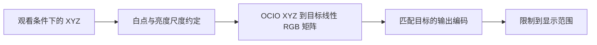

# 色彩管理与显示输出

固定颜色转换使用 OpenColorIO；主配置为官方 ACES 2.0 CG Config v4.0.0，
另保留 Jed Smith 的 OpenDRT 外观。
三条胶片模拟流程共用这部分处理。E100、5207 APD 和光学放大均已接入；
材料模型的验证范围见[流程核查](5207-pipeline-audit.zh-CN.md)。

## 当前应用的选项

2026-10-27，显示面板分为「输出目标」和「显示外观」，光谱与试片模式共用同一份配方。

| 类别 | 可选项 |
| --- | --- |
| 输出目标 | sRGB、Display P3、Rec.709 / Rec.1886 |
| OpenDRT v1.0.0 | Default、Colorful、Umbra |
| OCIO 官方 ACES 输出 | ACES 2.0 SDR 100 nits |
| 色度转换 | Display Encoding：XYZ D65 直接转目标线性 RGB，再执行目标传递函数 |
| 检查视图 | Bypass（保留配置的数值旁路） |

反转片与光学放大默认使用色度转换；负片 APD 输出默认使用 ACES 2.0 SDR。
输出目标均默认为 sRGB。OpenDRT 保留为可选外观，不同时叠加 ACES 输出变换。
旧配方未写输出目标时按 sRGB 解释。
修改外观或输出目标不改变材料 XYZ；A 对照仍固定为原场景 XYZ→sRGB。
预览 PNG、照片导出、显示 CUBE、完整 CTF 和误差评估都使用选择的显示链。
内部 XYZ LUT 不含显示变换，误差评估仍按所选显示目标进行。
用户界面只导出显示 CUBE；内部 XYZ、完整 CTF 和构建记录保留在开发接口，
不再作为导出窗口中的用途选项或记录入口。
显示节点默认打开「转换过程」：从当前取样点的 XYZ D65 开始，列出经 OCIO
默认优化后的实际操作，包含矩阵与偏置、LUT 维数和尺寸、执行方向、传递函数，
以及逐步输入输出。矩阵按列向量显示；曲线图为等分量输入 v₁=v₂=v₃、范围 0–1
的执行剖面，不是光谱，也不能代替完整三维颜色映射。解析 ACES 运算按实际
算子展示，不伪装成 LUT；末尾的 0–1 输出限制单独列出。
P3 和 Rec.1886 图像内嵌本项目按标准色度与传递函数生成的 matrix/TRC ICC，
浏览器与系统据此做屏幕色彩管理；不把 P3 或 gamma 2.4 数值标为 sRGB。

Display P3 使用 P3-D65 原色与分段 sRGB 传递函数，区别于影院 P3 的 gamma 2.6。
Rec.1886 此处为黑位 0 的 gamma 2.4、Rec.709 原色。两者均为 SDR 文件目标。
目前 8 位 PNG 和 0–1 预览流程没有接入 HDR 亮度或 PQ/HLG 编码，未列出 HDR 目标。

所用 OpenDRT mini 包只有 Rec.709 渲染 LUT；P3 目标通过线性 Rec.709→XYZ→P3
正确转换文件编码，不会凭空增加原 LUT 的渲染色域。配方条件明确记录此限制。
ACES 2.0 直接使用下表所列官方配置视图，不在其后再次添加 OpenDRT。

| 输出目标 | 官方 Display | 官方 View |
| --- | --- | --- |
| sRGB | sRGB - Display | ACES 2.0 - SDR 100 nits (Rec.709) |
| Display P3 | Display P3 - Display | ACES 2.0 - SDR 100 nits (P3 D65) |
| Rec.1886 | Rec.1886 Rec.709 - Display | ACES 2.0 - SDR 100 nits (Rec.709) |

2026-10-27 核对[官方发布](https://github.com/AcademySoftwareFoundation/OpenColorIO-Config-ACES/releases/tag/v4.0.0)，
锁定 `cg-config-v4.0.0_aces-v2.0_ocio-v2.5`，由当前依赖 OpenColorIO 2.6.0 的
内置注册表载入并验证。配置修订 4.0.0、ACES 算法 2.0、OCIO 配置语法 2.5
与运行库 2.6.0 是不同版本号。未使用会自动改变版本的 `ocio://default` 别名。
配置身份、序列化内容 SHA-256、库版本及所选 Display/View 写入计算条件。

XYZ D65 先通过官方 AP0↔XYZ Bradford 工具变换的逆方向进入 ACES2065-1，再执行
上述目标视图。已用独立的 AP1 桥接与官方配置对照，并检验预览和 CTF 文件执行。
ACES 1.0/1.1 的显示运算实现已移除。旧配方和旧工作区（包括对照配方）载入时
自动改为 ACES 2.0，配方版本增加一次；输出目标、材料、照明和曝光保留。
再次载入已迁移配方不会重复增加版本。预览、照片导出、LUT、CTF 和当前比较脚本
都使用这套 2.0 显示；历史数据里的旧版本名称仅用于记录来源。
OpenDRT 独立采用已锁定的官方 mini 包。

APD 曲线图显示范围改为 400–750 nm，保留完整红端。标准响应的来源与积分仍为
360–730 nm；730–750 nm 不补造权重。相纸感光图保留 400–750 nm，其他曲线的
400–700 nm 显示约定不变。

## 各部分负责什么

| 部分 | 负责的计算 |
| --- | --- |
| 光谱程序 | 胶片和相纸响应、透射／反射谱、标准 APD 密度积分，以及观看颜色的 XYZ |
| 负片标准输出 | 按冻结定义处理 APD／ADX、Dmin 和通道尺度，以锁定版本的 APD/ADX-to-ACES 接入声明的 ACES／XYZ 接口；现已复现 ACES 1.2 ADX16 a1.0.3，参见流程核查 |
| OpenColorIO | 按配置执行输入解码、颜色空间转换、白点适应、显示视图和输出编码 |
| OpenDRT | 提供显示成像的色调和颜色处理，由选定的 OCIO 配置调用 |

OCIO 不代替胶片模型或标准 APD 数据。OpenDRT 的外观处理也不作为
胶片材料准确性的证据。

普通 RGB 输入先经 OCIO 转到声明的工作空间；解码不会恢复丢失的光谱或
撤销输入照片中未知的显示处理。输入光谱程序的仍是声明条件下的近似。

图像调色、预览与导出主要使用普通 RAW。计划由 RawTherapee 与相机配置模块先处理传感器数据、
白平衡和匹配的 DCP／矩阵，再将声明空间的颜色交给 OCIO。DCP 的白平衡、
矩阵及颜色表须按其定义处理，不将 `.dcp` 当作 OCIO 普通 LUT 文件。
此输入环节不要求相机光谱响应，见 [RAW 输入与相机配置](raw-input-and-dcp.zh-CN.md)。

## 三条流程的出口

应用内将材料 LUT 与显示处理分开。材料 LUT 根据当前光谱节点生成，
拟用指定范围的 ACEScct 输入和具有保存尺度的相对 XYZ D65 输出；显示
模块在其后执行。换胶片或观看光源时重算胶片 LUT，换 OpenDRT 预设时
更新显示处理。对外的一体 LUT 可以合并这两部分。

相纸与反转片的出口为带观看条件的观察 XYZ，已包含材料成像。默认流程为：

XYZ 保留原始观察者、白点、Y 的尺度及观看亮度记录。若主动选用 OpenDRT
作为额外创作外观，桥接须明确到 AP1、D60 的转换与亮度尺度。转换后的
三个数值采用线性 RGB 坐标，并不因此成为原始场景辐射量。将它们交给
OpenDRT 是声明过尺度的显示成像选择，需要检查对相纸和反转片的色调影响。

白点适应和尺度转换写入处理链，记录在哪一步执行。已适应到目标白点的
数据不重复适应。显示变换不改写保存的原始 XYZ 和光谱结果。
胶片 LUT 输出已经完成的 D65 适应与尺度处理也遵守此约定，显示模块不重复执行。

负片流程为透射谱 → 标准 APD 密度 → 标准输入转换 → ACES 2.0 显示输出。
OpenDRT 可替代末端 ACES 显示，不叠加执行。标准输出节点
内部展开 APD／ADX 的数值与编码约定、Dmin、通道增益、APD/ADX-to-ACES
和到相对 XYZ D65 的桥接，不向用户增加翻拍设备节点。APD 浮点密度、
ADX 编码、ACES2065-1（AP0／D60）与 XYZ 分别标明，不能直接互换。

Status M 资料接入 APD 的矩阵与偏置属于材料内部默认步骤，不增加主流程
节点或启用开关，只在专业详情展开。它处理密度定义，不能替代后续的
APD/ADX-to-ACES；已从透射谱直接计算的 APD 不重复转换。相应片基约定、
数据来源和误差见 [APD 与 ADX](apd-adx.zh-CN.md)。

转换参考锁定为 [aces-core v1.2（2019）](https://github.com/aces-aswf/aces-core/tree/v1.2)，
具体变换版本与依赖已记录于核查。标准输出不是 RGB 反相，也不保证严格
恢复原始场景。APD 定义和标准数据要求见
[方法](science-and-pipelines.md#negative-apd-and-standard-output)。当前 5207
已接入参考计算，界面的 APD、ACES 和 XYZ 来自实际执行结果。

## 显示视图与色度检查

反转片与相纸的默认预览使用色度转换，APD 默认使用 ACES 2.0。
材料验证仍比较光谱和 XYZ；OpenDRT 是另外选择的创作处理。不同结果
分别命名，不能将显示成像后的色差写成材料模型误差。

GUI 将“显示输出”作为固定末端节点。常用面板提供输出目标和 OpenDRT
外观预设；配置、输入空间、Display、View、文件编码和亮度约定展开后查看。
输出目标绑定已经验证的显示与编码组合，避免要求用户分别拼装。

官方配置中已烘焙的外观按预设切换。要开放连续参数，须先有与参数对应的
变换实现或重新生成的配置资产，并验证其结果。不能让界面参数与实际使用
的固定 LUT 脱节。

预览、图像导出和显示烘焙 LUT 使用同一份保存的处理配方。屏幕目标与文件
目标不同时，只在约定的显示编码部分分支；不得重新套用一次 OpenDRT。
系统或窗口的显示管理也须检查，避免重复转换。

## 核对过的官方配置

2026-10-26 核对了 OpenDRT 的官方说明、发布目录和以下配置包：

- 发布页：[OpenDRT v1.0.0](https://github.com/jedypod/open-display-transform/releases/tag/v1.0.0)。
- 文件：[OpenDRT_v1.0.0_mini-config_v2.zip](https://github.com/jedypod/open-display-transform/releases/download/v1.0.0/OpenDRT_v1.0.0_mini-config_v2.zip)。
- SHA-256：`c1a60bb4bd77bc2ae9c897143f9036229d816a9009aed58cfd4c5933fe9f6cc1`。

文件名中的 `v2` 是配置包修订号。包内实际使用 `ocio_profile_version: 1`，
不能据文件名判断为 OCIO v2 配置语法。应用仍计划使用 OCIO 2 API，接入时
验证具体库版本与此配置的兼容性。

该包包含 ACEScg、ACEScct 等输入空间，参考空间为 FilmLight E-Gamut2
Linear。Display 为 `Rec.1886` 和 `sRGB Display`，OpenDRT 外观预设为
`Default`、`Colorful`、`Umbra`。它使用传递函数表和已经烘焙的显示 LUT，
不是可在 OCIO 内任意调参的 OpenDRT 源程序。

包内 `sRGB Display` 使用纯 2.2 幂函数；另有 `sRGB Encoding` 颜色空间
使用分段 sRGB 编码。图像或 LUT 声明为标准 sRGB 文件时，须在 OpenDRT
显示结果之后，通过 OCIO 匹配到相应文件编码。不能将纯 2.2 编码的值直接
标为标准 sRGB。具体转换要检查近黑部、白点和通道数值。

后续检查了配置用途和表内数值：`eocf_srgb_to_linear.spi1d` 实际执行编码，
输入 0.18 得到约 0.461356。上游 `sRGB Encoding` 颜色空间描述的是把编码
函数用作 EOTF 的非标准显示条件，因此反向调用这张表，得到约 0.027212；
它并不是标准 sRGB 文件编码器。实验保留上游包不改，在接入层先将
`sRGB Display` 解码为线性 Rec.709，再正向执行编码表。回归检查与独立的
标准分段 sRGB 公式比较，不能只凭颜色空间名称判断用途。

此 mini 配置本身没有 Display P3 或 HDR Display。当前应用在接入层增加了
上述 SDR 输出适配，保持上游包不变；HDR 仍未接入。

同日核对的 v1.1.0 发布列出了 DCTL 和 Nuke 文件，没有 OCIO 配置包。
v1.0.0 配置不能标为 v1.1.0 的实现。正式集成时记录具体包版本和哈希，
不自动跟随上游更新。上述文件仅下载到临时目录核对，尚未并入仓库。

该配置包及其传递函数表、显示 LUT 的许可记录为 MIT，包内含 `LICENSE.md`。
上游仓库主许可标为 GPL-3.0；不同文件分别保留自己的许可和来源记录。

## 导出与验证

OCIO 从第一份预览和图像导出开始使用；以后向用户输出完整 OCIO 配置或
CLF，是另一项交付，不影响现在采用 OCIO 作为执行库。

胶片 LUT 固定光谱先验、材料、曝光、标准密度与输出版本和观看条件，不包含
OpenDRT。它输出的 XYZ 仍有声明的观看含义，不命名为场景线性风格 LUT。
导出成完整显示烘焙 LUT 时，再合入固定的输入处理约定、OpenDRT 外观和
输出编码，或合入所选的纯色度转换。两者分别命名，使用时不重复显示转换。RAW 解码和逐图白平衡
仍在一体 LUT 之外。

导出记录 OCIO 库版本、配置与依赖文件哈希、源空间、Display、View、
OpenDRT 版本及预设、插值、输入范围、输出编码和亮度设置。记录相对路径，
不依赖机器上的全局 OCIO 配置或未保存的环境状态。

接入程序后需要检查：

- 配置可由 OCIO 载入，依赖文件齐全；执行配置验证和 `ociocheck`。
- 白点、亮度尺度和传递函数与独立数值结果一致；不重复白点适应、色调
  处理或编码。包含近黑、灰阶、负值、超范围值和高饱和样本。
- 官方烘焙配置与同版本 OpenDRT 原始实现的差异单独记录，尤其检查 LUT
  支持范围及边界处理。
- OCIO CPU 与 GPU 结果比较。光谱和桥接计算保留 float64 参考，不将 OCIO
  执行自动当作双精度参考；数值容差根据实际处理链制定并报告。
- 同目标下的预览、图像导出和 LUT 读回使用同一配方比较。文件编码另外
  核验；跨显示目标时，比较编码前的相同显示结果。

来源：[OpenColorIO 配置说明](https://opencolorio.readthedocs.io/en/stable/guides/authoring/authoring.html)、
[OpenDRT 说明](https://github.com/jedypod/open-display-transform/blob/af683323e2a8a63501f02c0a724ec538e3228ad0/display-transforms/opendrt/README.md)、
上述官方发布包。
