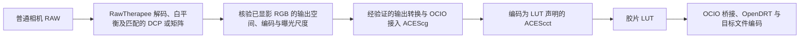

# RAW 输入与相机配置

桌面应用的核心是从光谱曲线和成像参数生成 LUT。普通相机 RAW 是图像
输入的主要入口：用户打开照片、设置白平衡和曝光，调整当前配方并导出
图像。不打开 RAW 也可以生成 LUT。RAW 显影交给 RawTherapee，应用集中
处理胶片配方与结果，不重做完整 RAW 编辑器。

用户不需要提供高光谱照片或相机光谱响应。高光谱数据用于建立和检验参考
模型，相机光谱响应作为可选测量资料积累。当前 RAW 入口的实际设置与测试见 [双路径交接](raw-handoff-and-batch.zh-CN.md)；下文的自定义配置与机型验证仍为目标设计。整体关系见[总体设计](system-design.zh-CN.md)。

## 默认输入流程

RAW 处理负责黑白电平、线性化、传感器通道尺度、去马赛克和白平衡等。
具体执行顺序由所选引擎与相机配置决定，并须记录。进入相机表征前，要
清楚数据已经做过哪些增益或白平衡处理，不能重复应用。

DCP 由具备相应支持的 RAW／相机配置处理模块解释。不能把 `.dcp` 当作
普通 `.cube` 文件直接交给 OCIO。相机表征与输出转换得到声明的颜色表示，
再由已验证的桥接接入工作空间，初期仍使用 ACEScg。

### RawTherapee 交接要求

当前接入固定 RawTherapee 5.12 CLI 与应用技术 PP3，输出浮点 sRGB 和线性 AP1 两条独立路径。较早的 5.8（2020）只保留为历史源码参考，不是当前运行版本。详见 [实现与验证](raw-handoff-and-batch.zh-CN.md)。

技术入口避免重复的胶片风格、自动色调与显示处理。是否启用高光重建、
降噪、锐化或局部处理须固定并记录；它们可能改变输入，不能纳入通用 LUT。

内部工作空间和输出文件配置分开核验。不能仅设置 ACEScg 工作空间，就
把导出 TIFF 当作线性 AP1/D60。若通过 ICC 文件交接，先按经验证的 ICC
转换或明确矩阵／TRC 得到声明空间，OCIO 不负责自动理解任意 ICC。
输出位深与格式待固定版本核验：整数 TIFF 需检查量化、高光余量及裁切，
不预设该版本提供可保留全部范围的浮点输出。

RawTherapee 的 “Save Reference Image” 位于输入配置之前，不作为已完成
DCP 表征的交接文件。接入验证同时检查输入配置是否真正生效、输出配置
和文件读回值，记录白点、亮度尺度、灰阶与曝光阶梯、负值和超范围处理。
必要时再评估浮点或进程内桥接，不用已经裁切的文件证明 HDR 输入成立。

此处的相机仅指拍摄原始数字照片的相机。5207 负片效果采用标准 APD 密度
与标准输出路径，不模拟翻拍相机或翻拍光源。DCP 留在胶片模拟之前，不参与
APD 定义或 APD/ADX-to-ACES 转换。

## 没有相机光谱响应时

默认入口采用经过验证、与机型匹配的 DCP 或相机矩阵。有可靠的相机光谱
测量时，另行验证能否改善该机型的胶片近似，不因存在光谱文件就自动替换
已经验证的输入配置。

| 可用资料 | 处理方式 | 能说明什么 |
| --- | --- | --- |
| 匹配机型的技术 DCP | 按所用配置的矩阵、白平衡及必要颜色校正表处理 | 该配置及测试条件下的相机色彩近似 |
| RAW／DNG 内嵌的有效相机矩阵，或来源明确的机型矩阵 | 按其方向、白点、通道尺度和白平衡约定转换 | 矩阵级近似，单独记录测试范围 |
| 自己拍摄的色卡与参考值 | 可制作和验证新的 DCP 或矩阵 | 不要求先测出相机光谱响应，但不能仅用训练色块证明泛化 |
| 可靠的相机光谱响应及照明资料 | 用于合成训练、检验或相机专用的光谱估计 | 仍受三通道信息不足、测量范围和通道尺度限制 |
| 没有匹配配置 | 提示选择或制作配置，也可从外部软件导入声明工作空间的图像 | 不静默借用另一机型，也不标为已校准 |

DCP 描述的是相机颜色转换，不是相机的逐波长感光曲线。不能从几个矩阵
或颜色表唯一恢复相机光谱响应，也不能用 DCP 解决同色异谱。若以后研究
由 DCP 约束估计响应谱，必须另记先验、拟合条件和独立测试，不能列为实测。

同样，色温、白平衡和双光源插值不提供真实的拍摄光源 SPD。未知光谱时
使用明确的假设，尤其需要检查 LED、混合照明和窄带光源下的误差。

## DCP 的使用范围

胶片模块前需要尽量少带主观风格的输入。默认选择经过检验、适合技术输入
的配置，避免先套一层厂商风格和对比度，再套胶片模型与 OpenDRT。

| DCP 内容 | 处理要求 |
| --- | --- |
| 机型和配置标识 | 核对机型、配置版本、来源和哈希；不能只凭文件名匹配 |
| `ColorMatrix` | 按 DNG 定义解释；其方向为 XYZ 到参考相机通道，不能直接当作相机到 XYZ 的矩阵 |
| `ForwardMatrix` | 可用时按规范处理白平衡及校准，得到 XYZ D50；缺失时采用规范允许的另一条路径 |
| 校准光源及插值 | 正确处理所支持的单／双光源配置；白平衡改变时更新相应矩阵与表 |
| `AnalogBalance`、`CameraCalibration` 等 | 与文件元数据一起解释，核对配置校准签名和增益是否已经应用 |
| `ProfileHueSatMap` | 视为配置的一部分，在规定的颜色空间、编码和顺序下处理，并检验其边界行为 |
| `ProfileLookTable`、`ProfileToneCurve` | 默认技术入口不叠加主观外观；需要它们的配置不能未经检验就删去后称为中性 |
| 基线曝光及配置曝光偏移 | 与用户曝光、传感器归一化分别记录，防止重复补偿或隐藏亮度变化 |

关闭 LookTable 和 ToneCurve 不保证任意 DCP 都变成准确的中性配置。
部分配置的矩阵与表相互配合；仅取矩阵也未必得到合理颜色。默认配置须
经过测试，矩阵回退另列为一种输入近似。

HueSatMap 可能包含非线性或边界裁切，输出不能仅因存成浮点或放入线性
RGB 坐标就声称全程保持曝光比例。需要检查曝光缩放、负值、超范围值和
饱和颜色；已裁掉的信息不能靠后续光谱重建恢复。最初实现的 DCP 标签和
传感器类型须列明，未支持的功能给出诊断，不静默略过。

## 胶片近似与快速 LUT

相机输入表征后，普通 RAW 与其他图像进入同一套胶片工作空间。胶片 LUT
由所选光谱节点计算产生，材料、曝光、标准输出和观看条件都属于生成配方。
运行时用 LUT 加速，不要求每张照片的每个像素都重新计算完整光谱。

生成端与加速端保留两种近似，使用相同的光谱参考和留出数据检验：

- 直接 RGB 近似：以所选光谱配方的计算结果训练或拟合加速模型，由工作
  空间 RGB 预测同一配方的输出。运行时没有完整的中间光谱；不能用独立
  调色代替光谱配方，也不能将未覆盖的参数组合当作已经验证。
- 光谱先验近似：由已声明条件的颜色估计光谱，再进入胶片参考计算。
  用于节点分析或生成 LUT；这些光谱标为估计值。

有实测相机响应时，可以另做利用相机通道与响应约束的近似，检验它相对
DCP 路径的收益。它不绕过三通道的限制，也不与 DCP 变换重复应用。

对普通用户，三条流程表现为“负片 APD”“负片放大到相纸”“反转片观看”
三类配方。曝光光源、滤色、相纸和观看光源是模拟设置，不要求用户拥有对应设备。
改变模拟光源也不能声称将原 RAW 场景真实地重新照明。

APD 是 Academy Printing Density，ADX 是密度交换编码；两者均不能当作
普通相机 RGB 或直接反相。当前仅 E100 可计算，5207 APD 的标准数据、
Dmin、通道尺度和标准转换版本仍待补。详见
[方法中的负片 APD 路径](science-and-pipelines.md#negative-apd-and-standard-output)。

`.cube` 接受已经处理好的三个颜色通道，不直接接受马赛克 RAW。黑电平、
去马赛克、逐图白平衡和自适应处理留在 RAW 流程中。

| LUT 类型 | 使用方法 |
| --- | --- |
| 胶片 LUT，输出显示成像前颜色 | 先完成相机输入处理，再按 LUT 的输入定义转换；LUT 后接 OCIO 桥接、OpenDRT 和输出编码 |
| 包含显示处理的 LUT | 先完成相机输入处理，再转到 LUT 指定输入；LUT 已包含固定的 OpenDRT 与输出编码，不再叠加显示成像 |

应用内使用第一类胶片 LUT，拟定接口为指定范围的 ACEScct 输入到具有保存
尺度的相对 XYZ D65 输出，OpenDRT 放在其后。该 XYZ 不声称为原始场景值，
外部宿主使用时必须按声明的输出定义接入，不能直接当作普通 RGB。

第一份计划对外发布的一体 LUT 仍为指定范围的 ACEScct 输入到标准 sRGB
文件输出，属于第二类。不同相机先分别做输入表征，再使用同一输入定义的胶片 LUT。
共享 LUT 不保证相机结果完全一致，相机表征误差会继续传到胶片效果中。

如果另做相机原生 RGB 专用 LUT，必须固定机型、配置、通道尺度、白平衡及
适用照明，单独命名和测试。不能把它当作适用于所有 RAW 的通用胶片 LUT。

## GUI 的默认操作

图像预览区提供打开 RAW、白平衡和曝光。胶片配方和 LUT 导出属于主流程。
同一配方也用于图像导出；普通调色无需先理解或手动导出 LUT。
相机配置自动匹配，
并显示实际使用的配置；用户可以替换为自己的 DCP。默认使用拍摄时白平衡，
也可用色温／色调或灰点工具调整，不能把这种调整标为实测光源光谱。

相机配置和白平衡的变化由输入环节处理。胶片或显示配方变化时，应用更新
相应计算或使受影响的 LUT 缓存失效并重新生成，不要求用户手动维护文件。
更换输入相机而仍使用相同工作空间定义时，可以复用对应的胶片 LUT。

常用操作区保留模拟流程条，可以直接点击光源、胶片、相纸和滤色节点来
替换或调整。原始曲线编辑、拟合和相机输入细节再展开。所选像素的相机
数值、工作空间颜色与输出颜色可以查看；光谱图由同版本配方重新计算，
标明估计及诊断性质，不能冒充 LUT 内部实际保留的数据。

用户修改光谱节点后，应用更新诊断与预览，后台生成并检验当前配方的胶片
LUT。OpenDRT 预设单独切换，通常不重算胶片 LUT。详细流程见
[光谱节点与桌面界面](spectral-nodes.zh-CN.md)。

相机响应图仅在有对应实测或明确估计的数据时显示。DCP 路径显示配置、
矩阵、颜色表和适用条件，不为缺失的相机响应补画三条曲线。

## 验证与资料记录

先在至少一个有匹配配置的机型上完成 RAW 到 E100 效果的图像输出与读回，
再扩展相机覆盖。记录 RAW 引擎与版本、机型、黑白电平、解码设置、配置
哈希、启用的 DCP 内容、白平衡、曝光约定、工作空间和最终 LUT。
还需记录 PP3、RAW 引擎二进制、输出配置与桥接版本，比较预览和导出
读回结果，并检查是否重复白点适应、曝光补偿或 OpenDRT。

输入表征、胶片近似、显示处理和 LUT 误差分别测试。相机输入测试使用
未参与配置拟合的颜色和场景，检查单／双光源、白平衡插值、曝光阶梯、
高饱和颜色与边界。资料允许时，加入多机型的同场景比较和不同照明。

光谱数据仍用于研究端的模型拟合与独立测试，不能从用户随意导入的 RAW
产生真实胶片准确性的结论。跨相机的一致性也须实测，不能靠 DCP 文件存在
就判定通过。

DCP、相机矩阵和 RAW 示例分别记录来源及许可。用户导入私有配置不等于
允许项目重新分发，不能直接打包其他软件安装目录中的相机配置。

参考：[Adobe DNG 1.6 规范，第 6 章](https://helpx.adobe.com/content/dam/help/en/photoshop/pdf/dng_spec_1_6_0_0.pdf)、
[RawPedia 色彩管理](https://rawpedia.pixls.us/color_management/)、
[RawPedia CLI](https://rawpedia.pixls.us/command-line_options/)、
[DCamProf 文档](https://rawtherapee.com/mirror/dcamprof/dcamprof.html)、
[Making a camera profile with DCamProf](https://rawtherapee.com/mirror/dcamprof/camera-profiling.html)。
