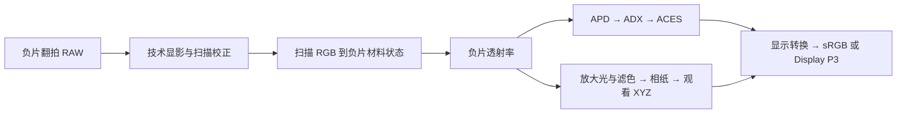

# 翻拍负片正相 LUT

2026-10-27，2026-10-29 更新。用户确认目标为“去色罩并正相，直接得到可显示的正片”。
本文是扫描用途的设计与验证要求。现在增加了独立的本地 float64 标定／反演实验，
使用 000003 实测透射色卡、配套 RGB 平场和真实 5207 翻拍；应用界面尚未接入扫描
标定、扫描反演或扫描 LUT 导出。见[真实翻拍实验](scan-negative-experiment.zh-CN.md)。
本地冻结标定已可生成[65³ CUBE 与 CLF](scan-65-lut.zh-CN.md)，依旧标为联合响应
估计实验；[独立实测 A7R V 数值曲线](a7rv-response-source-audit.zh-CN.md)尚未取得。

## 两种输入，一个负片模型

普通照片模拟：场景 RAW → 技术显影／相机表征 → 场景 RGB → 模拟曝光与显影
→ 负片透射率 → 选择正相方式 → 显示。

翻拍负片正相：负片 RAW → 扫描专用技术显影与校正 → 扫描 RGB → 反求负片材料
状态与透射率 → 选择正相方式 → 显示。这里不能再把恢复出的负片送入一次模拟
胶片曝光与显影，也不能套用现有普通照片 LUT 代替扫描反演。

材料仍保留自己的冲洗条件和测量定义，例如 ECN-2／Status M、C-41／Status M。
APD 是正相输出分支的密度定义，ADX 是其编码；两者都不是扫描相机 RGB。
选择 APD 或相纸正相不改变负片材料的化学处理身份。C-41 经当前电影输入变换
正相属于实验组合，需要独立的片种验证。

## 用户节点

界面分为“采集系统”“负片材料”“正相与显示”三组。普通用户选择已标定的采集
预设和片种；专业用户可展开以下数据。光谱曲线继续采用有量纲、固定表头的 CSV。

| 节点 | 需要记录的内容 | 作用 |
| --- | --- | --- |
| 扫描光源 | 实测相对能量 SPD、波长范围、测量条件、哈希 | LED 不能仅凭色温还原；决定负片如何被照亮 |
| 光路 | 镜头、扩散板、玻璃、滤镜的合成透射率；必要时拆分 | 与扫描光和相机响应合成采集权重 |
| 相机 | 有效 RGB 光谱响应、测量单位及是否已包含 CFA／IR-cut／镜头 | 预测传感器三通道读数；机型名称只是查找入口 |
| 片基与灰雾 | 同卷已显影未曝光片基，优先配套实测；包含与否明确 | 确定基准密度及橙色片基贡献 |
| 染料与掩蔽模型 | CMY 净密度谱、允许系数范围、已知掩蔽／层间效应及缺失项 | 反求材料状态，不能用固定 RGB 白平衡替代 |
| 胶片特性与标定光 | 本片种的 Status M 曲线、日光／灯光平衡条件 | 约束材料状态；需要恢复原场景曝光时才进一步反演 |
| 正相方式 | APD／ADX／ACES，或光学放大 | 从同一份负片状态得到正片 |
| 相纸分支 | 放大灯 SPD、滤色透射率、相纸感光与特性／染料模型、观看光 | 采用各自测量与处理条件，不借 APD 充当相纸曝光 |
| 显示 | 输出空间、白点、显示外观及固定版本 | APD 默认 ACES 2.0，相纸默认色度转换；导出带显示 |

有效相机响应若已包含 IR-cut、CFA 或测量镜头，不得再次乘入这些响应。量子效率
与每单位能量的响应要区分，不能重复或遗漏光子转换。模型范围以外的 IR／UV
影响不能通过缩窄图表显示范围隐藏。

“胶片日光／灯光平衡”是材料的标定条件；“原拍摄场景照明”是拍摄条件；“扫描
灯光谱”是读取现有负片的条件。三者分别记录。恢复负片透射率时，不需要把原
场景光再乘一次。若用户要求中和原场景色偏，则需要额外的原场景／白平衡假设，
不能仅因某片种为灯光卷就自动中和整张照片。

## float64 前向参考与反演

采用逐像素前向参考，波长为 nm，积分含实际采样宽度。在线性、黑电平已处理的
传感器通道域，以明确的相对曝光／通道增益预测采集：

\[
\hat c_i=b_i+g_i\int E_{scan}(\lambda)\tau_{optics}(\lambda)
T(\lambda;\mathbf a)S_i(\lambda)\,d\lambda
\]

\[
T(\lambda;\mathbf a)=10^{-[D_{base}(\lambda)+\sum_j a_jd_j(\lambda)]}.
\]

`b` 是尚未扣除的剩余偏置／杂散光项，不能与 RAW 黑电平重复扣除。现有模型的
`d` 可以是带符号的 D-min 扣除净密度；合成绝对密度必须非负。不能因为采用了
净密度就把每条染料谱截成非负数，也不能把 `T/Tbase` 一律截到 1。

先以已知增益、片基帧和暗／杂散光标定约束尺度，再对有效三通道读数做有边界
的加权非线性拟合，求 `a`。保留噪声权重、拟合残差、边界命中和局部雅可比的
条件数。三个通道与三个系数并不保证稳定或唯一；通道相似、窄带灯或强吸收区
可能使反演病态。剪切或接近噪声底的通道不能被当作可靠密度读数。

片基归一化 `u=(c-b)/(cbase-b)` 和 `-log10(u)` 可作为标定与初值，但这些量是
相机通道的相对密度，不是 Status M，也不是 APD。除片基能处理基准色偏，却
不能单独纠正随染料量变化的串扰和掩蔽。向 APD 分支交付时必须恢复含片基的
绝对透射率，避免把归一化后已经删除的片基贡献丢失或重复扣除。

特性曲线给出中性曝光轨迹，并不完整规定所有有色负片状态。扫描反演不能强迫
所有像素落在一条中性轨迹上；需另外记录 CMY 状态范围和相应物理有效性。现有
借用 5207 的染料模型仍是借用，不能因扫描拟合有解就称为对应片种实测模型。

## 必需的非光谱标定

一次“扫描系统标定”应保存相机和镜头、ISO、曝光、固定白平衡／通道增益、RAW
引擎及技术设置、源与参数哈希，并至少提供以下检查：

- 暗场或明确的传感器黑电平；灯具空场和平场校正，检查照明不均与暗角。
- 同卷已显影未曝光片基帧；与正式扫描相同的灯光、曝光和光路。
- 遮光黑参考或高密度阶梯，估计会污染对数密度的杂散光与噪声底。
- 密度阶梯、透射色卡或有配套密度／透射测量的负片，用于拟合与独立验证。

平场、空间杂散光、多帧 HDR、去尘和颗粒处理属于图像预处理，不能装入一个
位置无关的 3D LUT。片基／暗值可固定进标定，但对应曝光和单位必须固定；曝光
变了需先按已核验的比例归一化，不能继续套用原偏置常数。

只有机型 DCP 时，可开发基于实测透射样本的经验标定；DCP 不能唯一提供相机
光谱响应。缺少响应谱或扫描实测数据时，应记录缺失条件，不静默借另一机型并
宣称标定完成。相机匹配的普通场景配置也不等于经过负片扫描校验的配置。

## RAW 与单文件 LUT 的边界

`.cube` 接收三个数，不能读取 RAW 马赛克。最终操作可以是一键应用：应用先
按冻结的扫描技术预设用 RawTherapee 显影、执行图像校正，再套 LUT，输出正片。

扫描入口需要新增并核验独立的技术交接。目标是未剪切的线性相机通道，或一个
已明确、可复现且经验证的固定技术变换输出；随后定义固定的 LUT 输入编码与
范围。不能把现有 AsShot／相机配置 → ACEScg 的普通场景入口直接叫作相机原生
数据。若选择在工作空间应用，必须把相同的通道增益、输入配置、曝光偏移、矩阵
与编码纳入标定，检查其可逆性／裁切，不能再重复应用一次 DCP。

LUT 构建时冻结采集标定、材料和正相／显示设置，将上述逐点组合采样为一个
3D LUT。必要的固定一维输入编码属于声明的交接条件；是否可烘焙到单文件及
网格精度由实测范围决定。不要预设现有普通照片的 ACEScct 网格适合扫描阴影。
头部记录用途 `scan-negative-to-display`、机型／标定哈希、输入编码／范围、片种、
光谱覆盖、片基处理、正相方式和实际输出 sRGB／Display P3。

## 验证要求与当前缺口

先建立独立 float64 前向／反演参考，检查已知密度和透射色块的传感器预测，
再比较优化内核。合成回代只能证明模型实现和求解器，不能证明真实扫描颜色。

用未参与标定的实测负片和配套扫描 RAW，分别评估传感器预测残差、密度／APD
误差、跨曝光稳定性、正相后中性与有色色块误差；检查不同位置、密度和片卷。
改变光源、相机增益或光路时验证标定失效与重建规则。拟合与测试不能使用同一
组色块冒充独立验证；中性拟合不能证明完整色彩准确度。

对每种网格另测最终显示 RGB 的 LUT 插值误差，展示 `2/255` 内比例、分位和
最大值，允许用户决定体积。该数值不代替扫描标定或材料真实性误差。

现在已有用户授权用于本地研究的 000003 逐色块透射测量和配套扫描／平场 RAW。
独立的相机响应、灯具 SPD、遮光暗场及真实 5207 的独立密度／APD／场景颜色
参考仍缺失。色卡拟合得到的是正则化的联合采集响应，不是分别测出的灯具或
相机光谱。普通摄影 RAW 测试库不能替代扫描标定样本；现有历史私有配置与
程序不被导入本项目。

## 依据

- [ACES 的 ADX 定义](https://docs.acescentral.com/encodings/adx/)：编码的是 APD；
  [APD 定义](https://docs.acescentral.com/encodings/apd/)及本项目已核查的
  [APD／ADX 来源和波段边界](apd-adx.zh-CN.md)。
- [RawTherapee Film Negative 文档](https://rawpedia.pixls.us/film_negative/)：现有
  工具采用逐通道指数反演，支持按卷复制标定；不是这里的光谱材料反演算法。
- [RawTherapee 色彩管理](https://rawpedia.pixls.us/color_management/)与本项目
  [当前普通 RAW 交接](raw-handoff-and-batch.zh-CN.md)。

这里的光谱前向模型、受约束反演和用户节点是本项目的设计推导，不将上述工具
文档当成扫描色彩准确度的证明。
