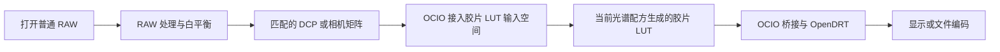
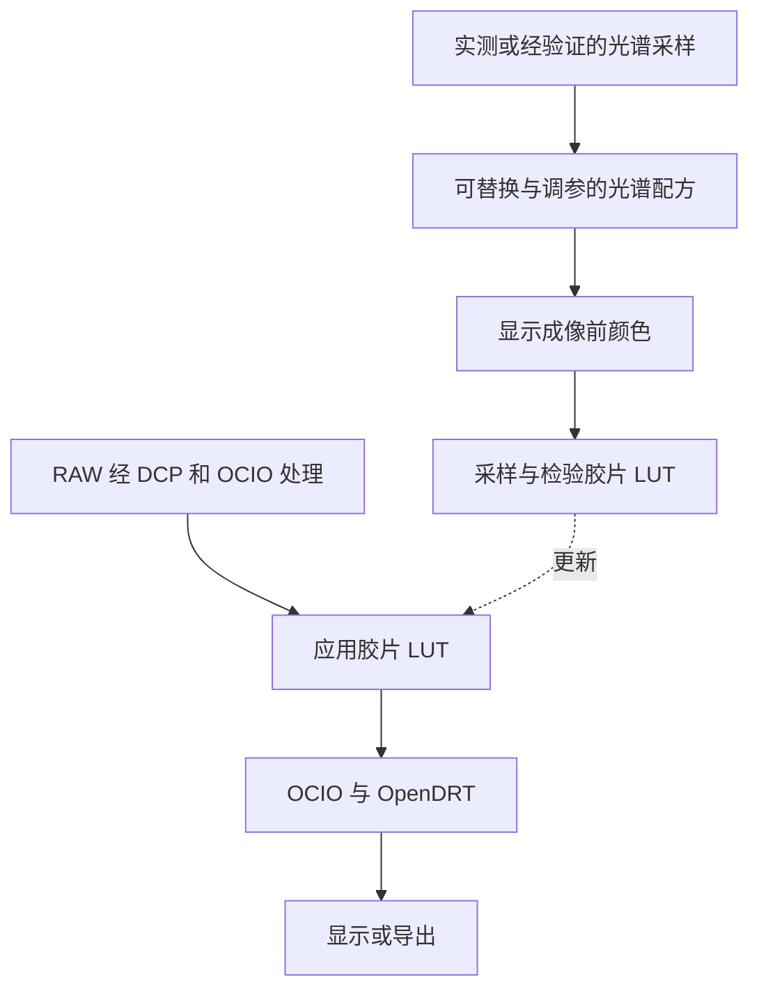
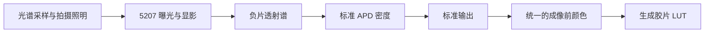
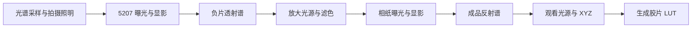
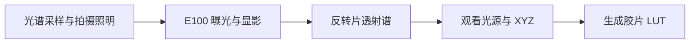
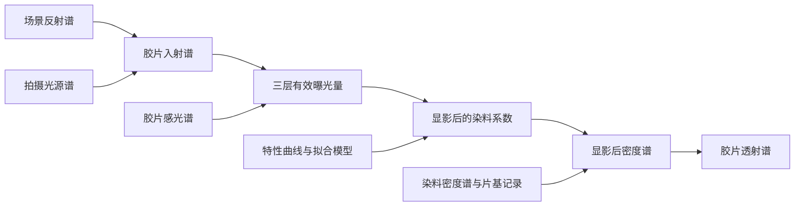
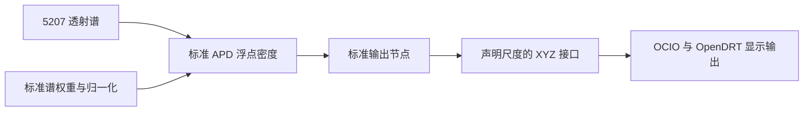
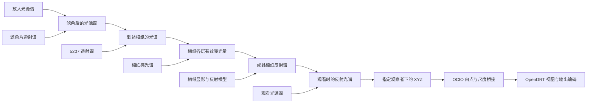
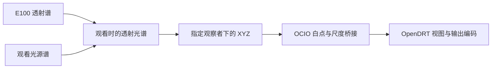

# 光谱节点与桌面界面

本文整理三种模拟的计算节点和界面要求。界面采用固定流程，允许替换节点
使用的材料和光源，并调整参数。三条流程均已有局部参考实现；材料准确度与 RGB 近似误差见[流程核查](5207-pipeline-audit.zh-CN.md)。
当前 65³ 规格和可点击的示意原型见 [GUI 设计](gui-design.zh-CN.md)。

应用的核心是从这些光谱曲线和参数计算 LUT。三种模拟是三套生成配方，
RAW 和 DCP 负责预览照片的输入处理。用户可以不打开照片，直接组合节点
并生成 LUT；图像预览用于帮助比较和调整。
每个节点必须保存的数据和条件见[生成 LUT 所需输入](lut-generation-inputs.zh-CN.md)。

主流程不设置「光谱估计」节点。生成 LUT 使用采样库中的光谱计算材料响应，
再建立输入 RGB 到该响应的近似映射；应用 LUT 的照片只需经过正确的输入
色彩转换。映射的拟合、域外处理及误差属于构建条件，不要求用户逐张恢复光谱。
0.1 后端目前仍采用原有平滑光谱先验作为临时 RGB 近似；移除界面节点没有
替换这段算法，完整的采样库直接映射仍需实现与验证。
反转片与相纸的 XYZ 积分和固定白点处理属于观看节点的计算详情，没有额外
可调参数，不单列「输出接口」。负片的标准输出包含 APD/ADX-to-ACES，保留。
桌面试片 A 固定为原始场景 XYZ→sRGB；B 为当前胶片配方。普通 RGB 没有
实测光谱时，A 标为原始 RGB 参考。

## 普通用户的 RAW 入口

用户不需要提供高光谱照片或相机响应曲线。相机输入模块负责 RAW 解码与
色彩表征；三条胶片流程位于其后。DCP 供输入表征使用，不当作相机光谱。
应用内的胶片 LUT 不含 OpenDRT，显示成像放在其后。对外导出时可以合成
包含显示处理的 LUT，使用这种一体 LUT 时不再叠加 OpenDRT。
详细定义见 [RAW 输入与相机配置](raw-input-and-dcp.zh-CN.md)。

默认显示胶片配方、可点击的模拟流程条和 LUT 导出；预览区提供白平衡和曝光。
用户可以替换光源和材料，在自己导入的照片上比较结果；原始数据、
拟合和定标放在展开的设置中。高光谱输入保留在研究端，普通 RAW 对应的
光谱如由重建得到，标为估计。

## 光谱配方怎样生成胶片 LUT

胶片 LUT 是当前光谱配方的计算结果。目标生成流程以光谱采样为输入，分别
计算对应的输入 RGB 和材料输出，再建立、采样和检验固定的 RGB 映射。
不需要把用户的每张照片先恢复成光谱。RGB 近似也须由材料计算产生的
输入输出训练和检验，不能用独立调色曲线代替材料计算后仍称为当前光谱配方。
0.1 的平滑先验仍属于现有临时实现，尚未换成上述直接映射。

生成与应用是两条处理线：

界面中用“换”表示可替换配置，用“调”表示可修改参数；透射谱、反射谱、
曝光量和 XYZ 是自动计算的检查结果，不作为普通用户手工绘制的输入。

### 5207 APD 配方

| 节点 | 换 | 调 | 点击后查看 |
| --- | --- | --- | --- |
| 拍摄照明 | 与采样条件相容的光源 | 有定义的曝光设置 | 光源与胶片曝光条件 |
| 胶片 | 配套感光谱、特性曲线和染料谱 | 有模型支持的材料参数；曝光锚点在高级设置 | 感光谱、曝光位置、密度和透射谱 |
| APD 密度 | 已核验的标准数据版本 | 标准权重固定，不提供改变后仍称标准 APD 的滑块 | 标准谱权重、覆盖、归一化、积分贡献和三个 APD 密度值 |
| 标准输出 | 已实现且锁定版本的 APD/ADX-to-ACES 与接口桥接 | 仅开放该实现有定义的参数；Dmin 与通道尺度须随配方保存 | APD 浮点密度、ADX 编码约定、标准转换和 ACES／XYZ 输出，内部展开 |

真实 RAW 的 DCP 只在原数字照片输入端。负片直接采用 Academy Printing
Density，不增加翻拍光源、传感器或翻拍反演节点。当前标准数据和输出转换
尚未实现，节点只说明待补条件，不显示伪造数值。

### 5207 光学放大配方

| 节点 | 换 | 调 | 点击后查看 |
| --- | --- | --- | --- |
| 拍摄照明与负片 | 与 APD 配方相同，可共享负片结果 | 同上 | 感光、特性、密度和透射数据 |
| 放大光源 | 光源预设或自定义 SPD | 放大曝光 | 放大光源与到达相纸的光谱 |
| 滤色 | 有数据的滤色片或明确的理想模型 | 滤色量 | 滤色片透射谱与滤色后的光谱 |
| 相纸 | 配套感光、显影和反射模型 | 有数据支持的模型参数 | 曝光位置、纸白和成品反射谱 |
| 观看 | 观看光源 | 观看亮度、已定义的适应设置 | 反射光谱和显示前 XYZ |

界面将放大曝光和观看亮度分别命名。用户可以先改变滤色，再换观看光源，
从光谱和图像比较“改变相纸曝光”与“改变观看条件”的不同结果。

### E100 透射观看配方

| 节点 | 换 | 调 | 点击后查看 |
| --- | --- | --- | --- |
| 拍摄照明 | 与采样条件相容的光源 | 有定义的曝光设置 | 光源与胶片曝光条件 |
| 反转片 | 配套感光谱、特性曲线和染料谱 | 有模型支持的参数；曝光锚点在高级设置 | 感光、曝光位置、密度和透射谱 |
| 观看 | 灯箱或其他观看光源谱 | 观看亮度、已定义的适应设置 | 观看光源与透射光谱、显示前 XYZ |

三个配方末端都不包含 OpenDRT。应用内拟用 ACEScct 作为胶片 LUT 输入，
以适应到 D65、具有保存的相对 Y 尺度的 XYZ 作为输出。APD 流程须先将
标准转换的 ACES 输出按声明的桥接转换到此接口。尺度基准、适应和增益随配方保存，不能
按每张照片重新归一化。这个 XYZ 接口用于连接显示模块，不表示恢复原场景。

## 用户怎样参与调试配方

1. 打开自己的 RAW，应用自动匹配的相机配置，选一条胶片流程。
2. 点击流程中的光源、胶片、滤色或相纸，换一个预设或调整一个常用参数。
3. 在照片上选取颜色，比较该样本调整前后的光谱、曝光位置和输出颜色。
   其他节点跟随同一取样点；可以固定旧曲线作对照。
4. 应用先更新样本诊断和预览质量的图像，再在后台生成当前配方的完整 LUT。
   显示“正在更新”及预览质量，不能把旧 LUT 的图像当作新参数的最终结果。
5. 完整 LUT 通过读回检验后替换预览，用户可保存自己的配方、导出 LUT，
   或继续比较下一个节点。

这里的 LUT 生成不以当前照片为唯一依据。它采样已声明的输入范围，按
固定的 RGB 到胶片响应映射逐点计算；选取照片只影响诊断样本及预览。整卷拟合
等操作须先保存状态，不能藏在每次 LUT 求值中。

常用曝光控制放在胶片 LUT 输入之前，改变输入到非线性胶片变换的数值，
不缩放已经完成的图像。高级设置中的材料曝光锚点、感光谱和特性曲线属于
配方本身，变更后重新生成胶片 LUT。两者分别标明，主界面不放两个同名曝光。

| 用户改变的内容 | 更新什么 |
| --- | --- |
| DCP、RAW 白平衡、输入曝光 | 重新处理输入；工作空间和 LUT 定义不变时可复用胶片 LUT |
| 胶片、光谱先验、模拟光源、滤色、相纸、观看条件或标准输出版本 | 更新所选样本和下游光谱计算，重新生成胶片 LUT |
| OpenDRT 外观或输出目标 | 更新显示处理；胶片 LUT 不变，一体显示 LUT 若已导出则需重新生成 |
| 取样点、图表缩放和曲线显示 | 更新检查视图，配方和 LUT 不变 |

每次生成保存配方版本和计算依赖。快速 RGB 模型、预览与最终 LUT 必须
对应同一个版本；未完成或未检验的结果不标为已生成的最终 LUT。

下文保留各物理节点的数量定义和现有材料限制。

## 共同的胶片曝光过程

5207 的 APD 和光学放大共用同一段负片计算。E100 使用相同的计算结构，
但换用反转片材料和显影模型。

| 节点 | 计算内容 | 界面显示 |
| --- | --- | --- |
| 场景与拍摄光源 | 反射谱乘以光源谱，得到胶片入射谱；曝光调整改变其曝光尺度 | 反射谱、光源谱和入射谱，分别标明量与单位 |
| 胶片感光 | 入射谱与各层感光响应积分，得到三层有效曝光量 | 三条感光曲线、各层加权积分曲线和曝光数值 |
| 显影 | 由有效曝光量和材料模型计算染料系数 | 原始特性曲线、模型拟合曲线及当前曝光位置 |
| 染料与片基 | 按有效系数组合密度谱，转换为透射谱 | 染料分量、合成密度谱和透射谱 |

曝光积分包含波长积分权重。感光响应若以对数记录，先转换为线性值；
使用量子效率与能量谱积分时，还要处理能量到光子数的转换。未有绝对校准
的数据使用声明的相对单位，界面不能将它显示为已测得的绝对曝光。

初始材料模型使用固定 CMY 密度谱和沿中性特性曲线拟合的有效系数。
Status A、Status M 等密度是指定测量响应下的结果，不能直接当作三种
染料的含量。特性曲线拟合与光谱密度合成须保留为两个步骤。

在该模型中，透射率由光谱密度按 `T(λ) = 10^(-D(λ))` 计算。只有单独测得
或明确建模的片基才能作为独立分量加入。E100 现有模型将未分离的片基吸收
包含在有效系数内，不能再叠加一次片基。

普通 RGB 照片没有实测的场景反射谱。使用光谱重建时，要注明重建方法、
假定光源和适用范围，曲线标为“估计光谱”。直接 RGB 拟合也可作为另一种
近似，但它没有完整的中间光谱，不能用另画的曲线冒充其内部计算。

## 5207 负片 APD 与标准输出

官方 Status M 资料接入时，应用默认在材料内部执行按片种绑定的 3×3
矩阵与偏置转换。它不占主流程节点、不要求手动启用；在材料专业详情
查看原始／APD 密度、来源、有效域和残差。缺少数据时说明缺项，不用
单位矩阵或其他片种静默代替。已有透射谱直接计算的 APD 不重复转换。
该步骤仍待实现，具体拟合与片基约定见 [APD 与 ADX](apd-adx.zh-CN.md)。

| 节点 | 用户可调整或替换 | 检查内容 |
| --- | --- | --- |
| APD 密度 | 仅选择核验后的标准数据修订；原标准权重冻结 | 波长覆盖、标准测量定义、归一化和 APD 三通道密度 |
| 标准输出 | 已实现且锁定版本的标准转换与桥接 | 内部展开 Dmin、通道增益、APD／ADX 数值约定、APD/ADX-to-ACES 和 XYZ 桥接 |
| 显示输出 | OCIO 输出目标与 OpenDRT 外观预设 | 输入空间、显示处理、文件编码及裁切情况 |

APD 依 SMPTE ST 2065-2:2012 定义，ADX 编码依 ST 2065-3:2012 定义。
标准权重、完整谱覆盖和归一化按原数据使用，不能把缺失波段补零后声称
符合标准。改变权重得到的是自定义密度，不能继续标为标准 APD。
APD 密度已经没有波长轴，按三个数值或条形图展示；谱权重与积分贡献才
使用波长图。

APD 浮点值、ADX 编码、ACES2065-1（AP0／D60）和 XYZ 不混用。标准输出
参考限定为 [aces-core v1.2（2019）](https://github.com/aces-aswf/aces-core/tree/v1.2)，
原 CTL 与精确依赖仍待读取验证。转换包含通道耦合与低密度曲线的处理要求，
不能以 RGB 反相或任意矩阵代替，也不保证严格逆回原场景。
标准定义与官方讨论见[方法](science-and-pipelines.md#negative-apd-and-standard-output)。

GUI 固定为 `light → film → apd → interface → display`。
`interface` 是一个标准输出节点，内部展开上述转换，不增加设备选择步骤。
5207 路线现已计算；当前材料尾端与模型 Dmin 的假设随配方记录，不据此宣称完整标准符合。
旧草案已配置的翻拍数据保留原文件，不静默解释为 APD 配方；另建 APD
草案时明确其尚不能复现旧结果。

## 5207 光学放大到 Ultra Endura

| 节点 | 用户可调整或替换 | 检查内容 |
| --- | --- | --- |
| 放大光源与滤色 | 光源谱、滤色片、滤色量和放大曝光 | 滤色前后光源谱、穿过负片后到达相纸的光谱 |
| 相纸感光与显影 | 相纸预设、特性曲线及已定义的冲洗模型参数 | 各层感光曲线、曝光位置和拟合曲线 |
| 相纸反射 | 已有的反射模型及其参数 | 纸白、成品反射谱和模型来源 |
| 观看 | 独立的观看光源、观察者、观看亮度与适应设置 | 反射谱、观看光谱、XYZ 和显示预览 |

放大光与观看光分别设置。前者改变相纸曝光，后者改变成品在该光源下的
观看颜色。相纸包含散射，不能直接套用胶片的透射模型计算反射率。

现有 Ultra Endura 结果来自成品反射谱拟合，纸白也是拟合值。尚无已知
曝光与成品光谱的成对测量来验证曝光到成品的预测。历史模拟的 3200 K
光源和滤色片是理想组件，界面须与实测设备预设区分。

## E100 反转片透射观看

E100 使用前述共同的曝光与染料计算结构，胶片透射谱直接进入透射观看，
没有负片反演和相纸曝光。

用户可以调整拍摄曝光、材料模型允许的参数、观看光源、观看亮度和显示
处理。图中同时显示 E100 透射谱与观看光源通过胶片后的光谱。有效染料
系数受约束，随曝光增加不增大；不能沿用负片的曲线方向。

历史计算将模拟 18% 灰放在 D50 视觉透射 Y=0.1，并可使用共享观看增益
1.8。这是模拟约定，界面不能标为绝对相机曝光校准。

## 界面安排

固定流程避免用户处理端口类型和接线，节点替换保留材料实验的自由度。
自由连线画布和逐页向导未采用：前者要求用户维护物理连接，后者不便比较
不同阶段。界面布局仍是建议，后续可用原型检查操作是否顺手。

- 顶部选择三种流程之一，显示当前配方名称。
- RAW 导入后显示匹配的相机输入配置，提供白平衡与曝光；不要求选择相机感光谱。
- 中间以图像预览为主，可比较调整前后，并选取像素或区域检查节点数据。
- 流程条显示当前路线的各个阶段。点击阶段后，打开对应参数与图表；
  共同的胶片曝光过程可收起，APD 与光学放大可以复用同一个负片结果。
- 节点面板先显示材料、光源、曝光等常用项。展开后再查看原始曲线、
  插值、拟合、定标和数据来源，展开与收起不改变计算结果。
- 光谱区跟随选中的节点，允许固定另一条曲线作比较。调整参数后，同时
  更新图像、当前光谱和受影响的下游结果。

初次使用从完整预设开始，替换一个节点即可实验。已有预设和原始测量
不被直接覆盖；自定义修改保存为配方或材料副本，并可撤销、单独复位。
用户可以导入自定义光源、感光响应、染料和滤色片数据，但须说明量、单位、
波长范围和归一化方式。没有对应数据或模型的冲洗变化不提供虚构参数。

这里的拍摄光源是模拟或重建所用的条件，改变它不能解释为将原 RAW 场景
真实地重新照明。RAW 的相机配置只属于原数字照片输入，APD 路线没有翻拍相机。

光源名称应对应实际光谱。相关色温只能描述光源的部分特征，不能用一个
色温数值代替 LED、日光等不同光源的光谱。简易调节仍须说明采用的光源
模型；自定义光谱可在展开的面板中导入。

## 固定的颜色转换与显示节点

三种流程共用 OpenColorIO 色彩管理和 OpenDRT 显示模块。相纸与反转片的
XYZ 先按声明的白点、亮度尺度和线性输入空间接入；APD 流程经版本锁定的
标准输出和 XYZ 桥接接入。颜色坐标转换不会把观看颜色变成原始场景辐射量。

常用面板按“输出目标、外观预设”操作。展开后可查看 OCIO 配置版本、
源空间、Display、View、实际输出编码和亮度约定。预览与导出使用同一份
保存的处理配方，图表继续保留显示处理前的光谱和 XYZ。

OpenDRT 的色调和颜色处理只执行一次。色度检查使用另一个不含 OpenDRT
外观处理的 OCIO 视图。官方配置中已烘焙的外观只能按已有预设切换；
没有对应变换的参数不显示为可用滑块。

OpenDRT 的 `sRGB Display` 与标准分段 sRGB 文件编码须明确区分。配置接入、
输出目标和读回验证见 [色彩管理与显示输出](color-management.zh-CN.md)。

## 图表怎样显示

每个节点显示它实际处理的量。光谱积分后的三个数值不再具有波长轴，
不能统一画成“光谱”。

| 数据 | 图表 |
| --- | --- |
| 光源与传播中的光 | 横轴为波长 nm，纵轴为声明单位的能量谱或相对谱 |
| 反射率、透射率 | 波长曲线，标明无量纲及材料测量条件 |
| 感光响应与传感器响应 | 波长曲线，标明线性或对数、能量或光子响应及通道尺度 |
| 光谱密度 | 波长曲线，纵轴为密度 D，并说明片基处理 |
| 特性曲线 | 横轴为 log 曝光，纵轴为相应定义的密度，标出当前曝光位置 |
| 有效曝光、染料系数、相机通道、XYZ | 分别显示数值或条形图，不互相当作 RGB 使用 |
| 显示输出 | 图像、数值及色域提示，颜色示意受显示条件限制 |

图表默认保留幅值，另提供只比较形状的归一化视图。归一化只影响图表，
不改变计算；比较不同单位的量时分图显示。密度和透射率可以切换，但不能
放在同一纵轴上当作同一种量。

取样时显示当前像素或区域。区域平均谱与该区域平均颜色分别计算，不能
把平均谱经过非线性胶片计算后的结果冒充平均图像颜色。光谱图附带来源：
实测、文献提取、拟合、RGB 重建或计算结果，并可查看所用的材料和光源。

缺失波段以空缺或明确标注的外推部分显示。不同节点的采样间隔、覆盖范围、
插值和积分方法可查看；不为图表好看而补出未测量的光谱尾部。

交互预览可以使用缓存和近似计算。所选样本可由 float64 参考程序重新计算，
并标明它与预览的差异；直接 RGB 近似没有的中间光谱不予伪造。

## 保存和 LUT 导出

配方保存完整的节点设置和数据版本，包括单位、通道尺度、光源、曝光基准、
密度定义、光谱范围、观察者、白点适应、观看亮度、输入输出编码及显示处理。
修改节点只需重算它和下游依赖；输入类型、单位或定标不匹配时，说明具体原因。
同时保存 OCIO 配置及依赖文件哈希、库版本、Display、View 和 OpenDRT 版本与预设。

LUT 导出列出将要固定的参数。整卷拟合、自动曝光等操作先完成并保存结果，
再导出逐像素颜色转换。颗粒、光晕和局部处理不写入静态 LUT。

每份 LUT 附带配方、输入输出定义、适用范围、校验结果和资料来源。界面中
看到完整的光谱计算，并不表示单个 LUT 能保存光谱或消除 RGB 的同色异谱误差。

计算定义见 [Methods](science-and-pipelines.md)，数据要求见
[Data and licensing](data-and-licensing.md)，验证要求见
[Development](validation-and-roadmap.md)。
