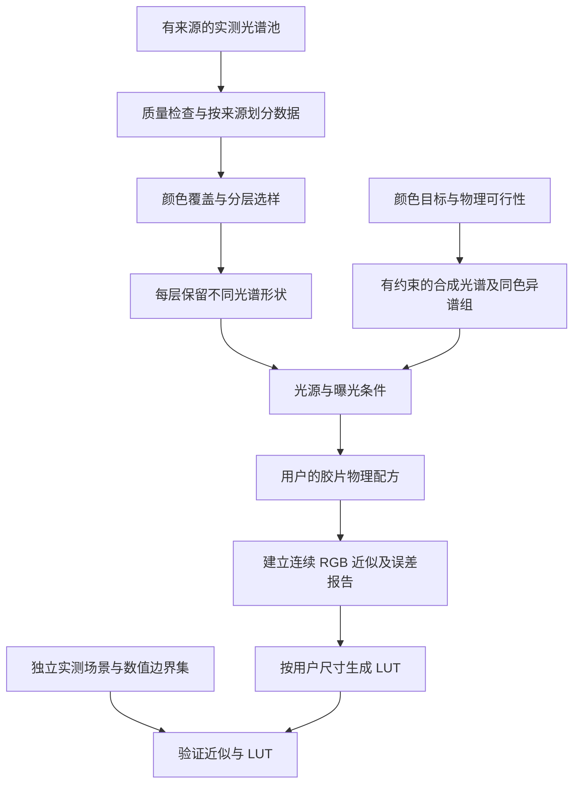

# 光谱采样数据库设计

本文记录用于构建胶片 LUT 的采样设计和小规模验证。已建立本地 0.1
反转片与负片输入库，分别选样、拟合和测试；正式数据分发与负片标准输出
在建立时仍待完成。2026-10-28 已将选定输入模型接入工作台、图像和 GPU LUT
流程；当前实现与验证见[接入记录](optimized-sampling-gpu-lut.zh-CN.md)。
下文的“本地 0.1”统计和选择结果属于原建立时的记录。

## 结论与适用范围

可以按声明的颜色空间设计均匀覆盖，但“均匀”必须带上坐标、距离、范围和
权重。建议建立按颜色坐标组织的光谱数据库：颜色覆盖用于安排样本，在
相同或相近颜色内保留不同反射谱，曝光和光源作为独立条件保存。

数据库与最终 LUT 的网格分开。数据库用来确定 RGB 近似及其适用条件；
确定连续转换后，按用户选择的 17³、33³、65³、129³ 或其他支持尺寸生成 LUT。
两者没有样本数必须相等的要求。

原始测量可以共享可追溯来源，反转片与负片的成品采样库、选样清单、模型
和标签分别保存。胶片、光源和处理参数改变时重新计算对应片类的输出标签，
原始反射谱不因此改变。5207 两条路径未实现前，不能为它们生成虚构标签。

## 本地 0.1 建立结果

`reversal.sqlite` 有 19,213 条谱及 E100 局部参考标签，`negative.sqlite`
有 19,212 条谱，仅完成输入重建验证。两库各有 9 组同色异谱压力样本和
1,810 个探针，错片类加载会报错，负片库不继承 E100 的观看与输出定义。

根据开发结果，反转片选用 512 条覆盖谱的局部先验；负片输入端选用按
来源平衡的三阶根多项式。E100 留出连续模型的平均码值误差从约 6.01
降到 4.50，负片输入留出光谱 RMSE 从约 0.0436 降到 0.0393。适用范围、
分开的插值／总误差与复现方式见[建立与迭代记录](../research/sampling-database-build.md)。

## 空间的“规模”不能只用体积表示

无界的场景线性 RGB 没有有限体积。即使限定范围，换编码、白点或坐标，
所谓均匀分布也随之改变。

| 均匀目标 | 适合解决的问题 | 单独使用的不足 |
| --- | --- | --- |
| 声明范围内的 ACEScct 坐标 | LUT 数值覆盖、暗部与高光检查 | 不等于视觉均匀；有些坐标没有对应的反射谱 |
| 线性 RGB／XYZ 坐标 | 线性积分、曝光及颜色体积分析 | 大量样本可能集中在视觉变化不大的区域 |
| 固定条件下的 Lab 或 CAM02-UCS 距离 | 颜色覆盖、减少近似颜色的冗余 | 相同颜色仍可能具有不同光谱；外观模型需固定观看条件 |
| 光谱形状及颜色零空间 | 保留同色异谱、材料与光源变化 | 光谱距离未必对应视觉或胶片误差，噪声也可能被当成差异 |
| 指定胶片配方的输出误差 | 补充高曲率、拐点和误差集中的样本 | 依赖材料与配方，不能替代通用原始资料库 |

第一版以 ACEScg AP1/D60 为输入接口、显式 D65 光谱条件作为参照。
Lab 可先作可复现的覆盖指标，不称严格视觉均匀。CAM02-UCS 等方案只有
固定适应亮度、背景和周边条件后才能比较，也不能直接套在无界 HDR 值上。
观察颜色不先经过 OpenDRT；显示预设变化不能改变数据库里材料颜色的定义。

条件记录要区分形成输入颜色的照明、模拟胶片曝光照明、放大照明和观看
照明。下面 `A_l` 中的光源指输入颜色的形成条件。普通 RAW 的真实光谱照明
未知时，只能声明输入近似；更换模拟胶片光源不等于重新测得 RAW 场景。
输入曝光与配方中的胶片曝光也分别保存，避免把逐图输入修正烘进通用 LUT。

## 用物理可实现域约束颜色目标

在给定光源与观察条件下，离散颜色积分可以写成：

```text
c = e × A_l × ρ
ρ：物体反射谱；A_l：包含光源、观察者、积分步长及 AP1/D60 桥接的矩阵
e：独立保存的曝光比例；c：声明接口下的线性颜色
```

对于理想的非荧光漫反射模型，检查 `0 ≤ ρ ≤ 1`。这个有界集合映射到颜色
空间形成物体色实体，不是简单的 RGB 立方体。曝光会缩放颜色实体，不能
把亮于单位白的目标一律当成超出反射率，也不能把曝光后的数值直接叫反射率。
RGB 通道为负也不单独作为物理不可实现的判据，应检查完整的颜色积分约束。

因此先规定基准曝光下的颜色目标，再单独安排曝光。对每个目标求有界
光谱可行性；没有解时记录不可实现或资料不足，不能把裁切后的另一种颜色
保存成原目标的成功样本。这里的有限波段可行性不等于全波段符合性。

首轮在当前 400–720 nm、D65 模型中，用同一组 512 个扰动 Sobol 点做线性
规划检查，结果如下。上限 16 指允许至多四挡的曝光缩放，不是反射率为 16。

| 均匀取点域 | 单位曝光、反射率 0–1 可实现 | 允许至多四挡缩放后可实现 |
| --- | ---: | ---: |
| 编码 sRGB 的 [0,1]³，经转换进入 AP1 | 512/512，100.00% | 512/512，100.00% |
| 线性 AP1 的 [0,1]³ | 459/512，89.65% | 510/512，99.61% |
| 当前 ACEScct 的 [-0.25,0.75]³ | 71/512，13.87% | 193/512，37.70% |

这是本次抽样与波段下的结果，不是色域精确体积、全部 sRGB 的数值证明或
某种编码优劣的排名。它说明数值测试点和有物理谱支撑的构建样本需要分别组织。

## 建议的四类记录



| 记录类别 | 内容 | 采用方式 |
| --- | --- | --- |
| 实测来源池 | HSI、IT8、ColorChecker、其他有来源的材料谱 | 保留原始测量与元数据，作为先验和实测验证来源 |
| 覆盖子集 | 在实测池内按颜色与光谱多样性选择的记录 | 减少冗余并覆盖已有分布，不宣称补齐了未测色域 |
| 合成覆盖与压力集 | 可行颜色的有约束重建、同色异谱、极端边界 | 明确标为合成，保存生成目标、约束、方法和残差 |
| 数值测试集 | ACEScct 立方体内部、表面、棱、角、灰轴和域外点 | 检查转换及插值；无真实谱对应时只验证定义好的 RGB 模型 |

实测、选样和合成不可混标成新的测量。合成数据量也不代表自然界中的
出现概率；训练权重、压力测试权重与实际照片分布分别记录。

## 怎样取得均匀覆盖

### 先选颜色，再保留光谱差异

建议采用分层选择：

1. 在固定条件下计算候选谱的颜色、亮度、光谱形状和质量标记。
2. 以亮度／曝光层及颜色距离安排覆盖；可比较最大最小距离选样、分层格点
   和低差异目标点。在不规则可实现域中，报告实际覆盖而非宣称严格均匀。
3. 每个颜色邻域继续选择不同光谱形状，优先保留颜色接近而胶片响应不同
   的记录。光谱差异不能只按前三个主成分判断。
4. 灰轴、近黑、接近色域边界、光谱狭窄吸收带单列，防止被体积采样漏掉。
5. 用与拟合分开的场景测试，依据覆盖收敛和输出误差决定继续增样的位置。

曝光先用固定材料可用范围分层，随后按特性曲线的趾部、肩部及输出变化
补点。光源先比较 D65、D50、A，再加入有来源的实测 LED；不能把若干色温
当作已覆盖所有 LED 光谱。不同光源、曝光和同一物体的近重复谱保持相同
数据划分，不把它们当成独立盲测样本。

最大最小距离会优先选择离群点，源数据须先做质量标记。PCA 按方差全白化
可能放大测量噪声，谱形距离应使用有依据的尺度和不确定度。已知约束下，
也可用颜色积分矩阵的零空间描述同色异谱差异；该零空间依赖光源和输入模型。

首轮从四张场景抽得 20,916 条候选谱，另外四张留出 5,376 条；同样采用
当前线性二阶矩先验，以 -2、0、+2 EV 检查连续 RGB 近似。512 条选样结果：

| 选择方式 | 留出颜色到最近选样的 P95 ΔE76 | 输出三通道均在 2/255 内，连续值 |
| --- | ---: | ---: |
| 随机，三个种子分别试验 | 23.23–28.31 | 50.95%–51.53% |
| ACEScct 最大最小距离 | 22.12 | 52.69% |
| Lab 最大最小距离 | 21.39 | 55.95% |
| Lab 与八维光谱 PCA 联合距离 | 22.32 | 54.87% |

Lab 选样在这个试验中有帮助，但 256 增至 512 时，其输出比例从 56.72%
降至 55.95%。覆盖更均匀、样本更多，都不保证当前拟合方法的预测更准。
需要分开比较选样、权重与重建方法。随机试验只有三个种子，不足以给出
总体显著性结论；八张场景仍是历史开发数据，不能视作最终独立测试。

本轮候选池中，518/20,916 条谱有反射因子大于 1，占约 2.48%；联合颜色／
谱形选择的 512 点中有 120 条，占 23.44%。这不证明这些测量错误，却说明
“距离大”会放大超出当前有界材料假设的记录，不能用空间覆盖代替质量分层。
颜色均匀权重、来源平衡权重与按原候选分布近似的权重应分别保存；它们
代表不同拟合目标，不能把原始像素出现次数当作自然材料的真实概率。

### 对资料没有覆盖的颜色

可在先验约束下生成光谱，但不能将其称为目标颜色的真实谱。一个候选形式是：

```text
最小化：光谱曲率惩罚 + 对实测先验的偏离
约束：A_l × ρ = c，0 ≤ ρ ≤ 1
```

同一颜色可保存多组解。用 `ρ = ρ₀ + N z`、`A_l N = 0` 表示等色方向时，
还需满足边界和形状约束；直接裁切负谱一般会破坏颜色匹配，必须重新核验。
所有合成点保存 RGB 回代残差、平滑约束与所属先验，不能把“解存在”等同于
自然材料存在。实测谱的凸混合不会扩展原颜色凸包，不能指望它补齐所有色域空洞。

## 同一颜色不能只保存一个胶片真值

胶片有效曝光使用的感光函数一般不同于观察者的颜色匹配函数。即使两条谱
满足相同输入颜色，胶片也可能给出不同输出。首轮构造了三组相同 AP1≈0.18
的合成压力谱，范围 0–1，10 nm 相邻变化不超过 0.08、二阶差分不超过 0.025。
输入回代误差小于 1.4e-16；当前 E100 模型的两端显示差异为 123–134 个码值。

这是按模型响应刻意构造的极端压力例子，不是新测量、自然场景误差预测，
也不验证该 E100 模型的真实准确性。但它清楚展示了数据库必须保留的信息。

对同一输入 c，若两种固定显示输出的某通道差异大于 4/255，则任何确定性
RGB LUT 都不可能同时对二者达到每通道 2/255。数据库更大不能取消这个限制。
要得到单值转换，需要声明代表谱或条件分布，以及选择、平均或拟合的目标。
在线性 XYZ 取均值与在显示后码值取均值是不同定义，不能混用。

因此每个颜色邻域除代表谱外，保留其他谱的来源、权重、胶片响应分散程度。
99% 的报告还必须说明分母是均匀数值点、数据库样本还是独立照片像素。
不能用 99% 自造样本通过来代表 99% 真实照片通过。

## 数据字段和划分

| 对象 | 至少保存的字段 |
| --- | --- |
| 来源 | 文档／数据集版本、作者、取得方式、原始哈希、许可及使用限制 |
| 实测样本 | 稳定 ID、来源场景／物体／批次、原始波长和数值、单位、测量几何与条件、不确定度、质量标记 |
| 派生光谱 | 父样本、算法与参数、随机种子、目标颜色、约束、求解状态、回代残差；明确 `synthetic` |
| 颜色条件 | 分别记录输入、模拟曝光、放大与观看光源 SPD；各尺度、观察者、积分方法、覆盖、白点与适应、RGB 原色与编码、输入与胶片曝光 |
| 构建标签 | 胶片／相纸配方指纹、软件版本、物理中间量、显示前输出，显示标签另记显示版本 |
| 采样记录 | 距离定义、分层、选择规则、权重、候选池哈希、选择索引和覆盖统计 |
| 划分 | 拟合／开发／最终测试、稳定来源分组；派生谱、同色异谱组、邻近像素和曝光变体不跨组 |

先按场景、物体和来源分组，再选样。严格测试需要后续取得的新数据集或
未使用过的场景／材料；不能在同一场景随机分像素后声称独立测试。
若某次盲测结果已用于调参，它就成为开发证据，应更换最终测试集。

保留原始网格；公共计算网格只是派生视图。第一轮只能使用共同的
400–720 nm／10 nm，不能把插值说成提高了实测分辨率。正式数据按所选
观察者与材料的完整覆盖要求建设，缺失波段用有效性掩码，不能补零。
APD 要求的 360–730 nm、窄带光源及更细吸收结构需另外取得足够资料。

本次场景里有反射因子超过 1 的记录，最高约 1.63。保留原数据，先核对
测量和标定含义，不能静默裁为 1，也不能无条件纳入普通有界漫反射模型。
反射谱、反射因子、辐射谱和透射谱分别标记，不以一套数值规则混用。

相机 DCP 只负责实际 RAW 输入的表征。上述色度输入是理想参照；不同相机
与 DCP 的误差还需独立测量。不能把统一颜色空间或更密的数据库当成跨机型
准确性保证，也不能从 DCP 恢复本来缺失的真实光谱。

## 实施顺序与通过条件

1. 固定 v0.1 的适用输入、曝光、参照光源、观察者、量纲与分组规则；登记
   已有资料。先不规定一个未经验证的“标准样本总数”。
2. 建立实测候选池及来源划分，做按颜色和谱形的覆盖报告。IT8 是其中一类，
   继续加入不同材料和自然光谱，不把摄影相纸的染料族当作全部自然物体。
3. 在相同预算下比较分层、最大最小距离、低差异目标点和随机对照；同时
   比较当前线性先验与有界非线性重建。选择方法使用开发集，最终结论用未用数据。
4. 给可实现目标生成标明约束的合成代表谱及同色异谱压力组。基准物理谱
   与包含负值／超范围的数值域分开报告，保持二者间的接口记录。
5. 逐个配方生成物理标签，评估 RGB 回代、谱形、胶片有效曝光和显示前 XYZ；
   再报告固定显示下的连续和量化码值误差。更换光源／材料不沿用旧通过率。
   自适应增样只使用开发集，根据当前配方的误差和曲率提出额外目标；通用
   实测池保持独立。采样规则和拟合权重改变时同样重建并验证近似。
6. 由连续模型生成用户选择规模的 LUT。分别检验文件完整性、插值误差与
   相对光谱参考的总误差。质量数据供用户判断，不以参考线禁止导出。

发布前要完成来源及派生数据权利审查。“自己设计数据库”不会改变上游
实测资料的许可。版本化采样规则、构建程序、来源清单和结果，保持可复现。

首轮程序为 [sampling_database_study.py](../experiments/sampling_database_study.py)，
复现条件与完整实验范围见[研究记录](../research/sampling-database-study.md)。

## 方法参考

以下研究均早于 2021 年；参考它们的方法和限制，不据此宣称本项目已复现：

- [Meng 等，2015](https://onlinelibrary.wiley.com/doi/abs/10.1111/cgf.12676)：三刺激值到有物理约束光谱及不可实现输入。
- [Jakob 与 Hanika，2019](https://rgl.epfl.ch/publications/Jakob2019Spectral)：平滑、有界的低维光谱重建。
- [Mallett 与 Yuksel，2019](https://doi.org/10.2312/sr.20191216)：固定照明下的 sRGB 光谱基与适用范围。
- [Logvinenko、Funt 与 Godau，2013](https://www2.cs.sfu.ca/~funt/LogvinenkoFuntGodauMetamerMismatchingTIP2013.pdf)：颜色机制变化与同色异谱失配。
- [Joe 与 Kuo，2008](https://researchcommons.waikato.ac.nz/items/6ded8a27-0cb2-4564-b221-35e814f5b93b)：低差异点序列。筛选／再优化后的样本需重新检查覆盖，不能沿用原序列的平衡保证。
- [Colour 0.3.15 的重建方法目录](https://colour.readthedocs.io/en/v0.3.15/colour.recovery.html)：可核对的历史实现入口。
