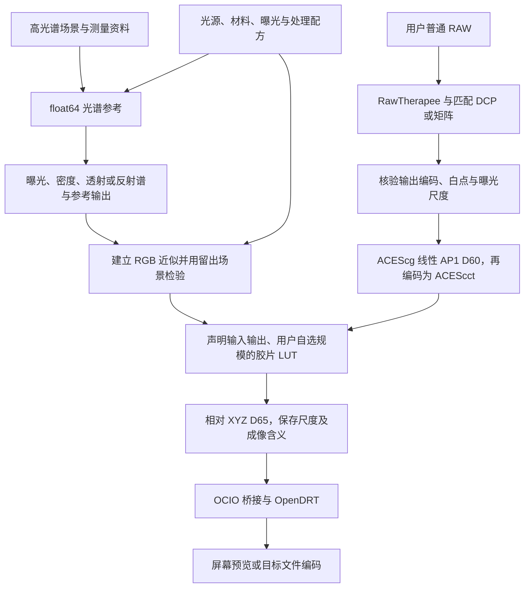

# 从光谱配方到普通 RAW

本文记录桌面应用的目标架构。现有实现覆盖本地 E100 参考、C++23 float64
逐点内核和 macOS 开发版窗口，见[本地桌面版 0.1](application-v0.1.zh-CN.md)。
RawTherapee 接入、5207 APD、相纸流程与独立安装包仍待开发。

## 两条计算链，共用一份配方

应用根据光源、胶片和成像条件计算 LUT，再把这份 LUT 用到经过正确颜色
表征的普通 RAW 上。普通用户可以打开照片、选择胶片、调整效果并导出图像；
专业用户可以修改材料曲线、检查光谱过程并生成自己的 LUT。
两种用法共用材料模型与参数，不另做一套与光谱模型无关的调色效果。

高光谱数据用于建立参考、拟合近似和检验误差，不要求用户提供，也不要求
处理每张 RAW 的每个像素时重新读入整组高光谱图像。

有限场景的光谱计算不会自动给出一个通用 RGB LUT。需要明确 RGB 到光谱的
先验，或定义由 RGB 预测参考输出的拟合模型，才能在整个声明输入域采样。
同色异谱造成的差异、RGB 近似误差与 LUT 插值误差分别报告。

## 三种固定流程

三条流程共用曝光和材料计算，分支只保留实际需要的步骤。

| 流程 | 物理计算 | LUT 的输出含义 |
| --- | --- | --- |
| 彩色负片 APD | 胶片感光、显影、透射谱 → APD → 固定的负片至 ACES 转换 → XYZ 桥接 | 负片标准输出转换的结果，不保证恢复原始场景 |
| 负片光学放大 | 胶片透射谱 → 放大照明与滤色 → 相纸曝光与显影 → 反射谱 → 指定条件下观看 | 相纸观看颜色 |
| 反转片观看 | 胶片感光、显影、透射谱 → 观看光源 → 指定条件下观看 | 反转片透射观看颜色 |

普通 RAW 的 DCP 在胶片 LUT 之前，只负责数字相机输入。彩负 APD 分支不
加入翻拍光源、翻拍相机或设备定标。相纸分支直接使用负片透射谱，不绕经
APD/ADX 编码再还原透射谱。

### 材料内部默认处理

负片官方特性曲线先按资料标注的密度定义读入；5207 的 Status M 数据不能
直接改名为 APD。Status M → APD 是隐藏但默认的内部转换，不增加主流程
节点、不要求用户打开开关或手动选矩阵。对应片种的 3×3 矩阵与偏置随材料
绑定，替换材料时自动匹配，专业详情可查看与导入校准数据。

这项转换发生在 Status M 数据接入 APD 的边界。已由透射谱直接积分得到的
APD 不再乘一次矩阵；E100 的 Status A 曲线也不套用负片的转换。
原始密度、转换结果、片基约定和拟合残差均保留。
详见 [APD、ADX 与密度转换](apd-adx.zh-CN.md)。

## 普通照片怎样接入

RawTherapee 负责 RAW 解码、传感器预处理、去马赛克、白平衡与相机配置。
应用负责其后胶片配方、图像比较和输出。首个接入方案采用固定版本的
RawTherapee CLI 和明确的 PP3，先验证一个机型，再扩展覆盖；必要时再评估
进程内或浮点数据桥接。参考代码版本先限定为 2020 年发布的 5.8，不能把
现行手册中的新功能当作该版本已经支持。

交接数据是已显影的 RGB，不是 RAW 马赛克。仅选择一个工作空间，不能证明
导出文件已经具有相同原色、传递函数和亮度尺度。接入前核验输出配置、位深、
裁切、负值与高光范围。ICC 输出需要已验证的颜色转换或矩阵／TRC 桥接，
不能默认交给 OCIO 就能解释。

缺少传感器光谱响应时使用匹配 DCP 或有来源的相机矩阵，并单独测试输入
误差。DCP 不恢复场景光谱。没有匹配配置时明确提示，不能静默借用其他机型。
详细契约见 [RAW 输入](raw-input-and-dcp.zh-CN.md)。

## 参数与界面

主工作区继续采用固定节点列表、当前节点的输入／结果图与对应参数。
照片是同配方的试片入口；可以完成日常调色与图像导出，不把图库管理和
一整套 RAW 开发工具都搬进节点区。

| 操作 | 普通使用 | 专业使用 |
| --- | --- | --- |
| 光源 | 选内置光谱、调模型支持的参数 | 导入 SPD、改采样点和归一化，检查单位及覆盖 |
| 胶片 | 换完整材料预设、调曝光和有定义的处理参数 | 编辑感光谱、特性曲线、染料谱，重新拟合并保存材料 |
| 相纸与观看 | 换相纸、滤色及观看预设 | 检查曝光到反射模型、纸白和观看条件 |
| 密度兼容处理 | 自动执行，不出现额外节点 | 在材料详情查看原密度、APD、矩阵、偏置和残差 |
| 输出 | 预览、比较、导出照片或 LUT | 查看空间、域、插值、显示变换及验证记录 |

标准 APD 权重和编码属于固定定义，不能作为改变后仍称标准 APD 的调色
滑块。光谱图显示当前输入与计算结果；三通道密度显示数值或条形图，不画
成虚构光谱。普通 RAW 的重建光谱标为估计值。

配方修改后只重算受影响的节点和下游缓存。LUT 尚未更新时显示配方版本
和预览状态；最终图像与 LUT 导出都等待同版本计算完成。输入白平衡变化
通常只重处理 RAW；材料、光谱先验或模拟照明变化重建胶片 LUT；OpenDRT
外观变化只更新显示部分。

## 构建、检验与后续采样

内部 LUT 的规模由用户选择，65³ 只作默认建议。工作台现支持边长 2–129 的
整数，常用 17、33、65、129。使用已声明的 ACEScct AP1/D60 输入范围，输出带尺度
和成像含义的相对 XYZ D65，OpenDRT 单独执行。光谱计算由参考程序负责，
Colour 提供经核验的色度学计算；ACES 约定空间与交换接口；OCIO 执行固定
颜色转换与显示处理。它们不能补齐缺失的材料测量或 APD-to-ACES 实现。

完整效果导出可用保持材料 LUT 与显示操作的 OCIO/CTF 包。单个包含显示
处理的 CUBE 必须另行验证，不能因内部材料 LUT 通过就宣称它也通过。

高光谱数据后续再优化采样。保留整场景的拟合／验证划分，再在开发集内
减少冗余，同时保留暗部、灰阶、高光、饱和颜色、照明变化及同色异谱样本。
同一张图的相邻像素和不同曝光不能分到训练与独立测试两侧。记录原始场景、
采样规则、权重和随机种子，先比较采样前后误差，再采用小样本版本。

最终标准 sRGB 在固定显示条件下，以 99% 像素的三个通道误差均不超过
2/255 为参考线，超过仍可导出，用户根据误差与体积选择。连续码值和实际
8 位量化分别检查，并展示样本数、平均、P95、最大值和检查范围。分别报告密度转换、材料模型、
RGB 近似和 LUT 数值误差。密度残差不能直接换算成屏幕的 2/255 保证。

目前本地 E100 的部分 LUT 检验不等于完整 RAW 路径、真实胶片或另外两种
流程已经通过。开发顺序与独立测试见 [验证计划](validation-and-roadmap.md)。

已验证一套 IT8 实测反射谱，并作为 LUT 构建素材试算，而非仅用作测试卡。
初次线性先验试验可生成 LUT，但未改善自然场景上的总误差，暂不替换默认
方法，详见 [IT8 构建试验](../research/it8-lut-trial.md)。

参考：[RawTherapee 5.8](https://www.rawtherapee.com/downloads/5.8/)、
[RawPedia 色彩管理](https://rawpedia.pixls.us/color_management/)、
[RawPedia CLI](https://rawpedia.pixls.us/command-line_options/)。后两者为持续更新
的手册，具体参数与行为须回到锁定版本核验。
